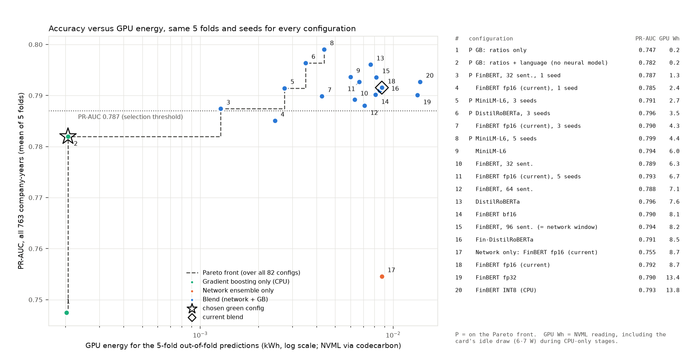

# Green AI study: accuracy versus energy cost

> **Read with the final report, Section 11.** This study ran on the data before the CARO-flag
> correction (blend 0.792 here, 0.807 in the report). The configurations that decide the conclusion
> (fewer seeds, no network) were rescored on the corrected data from the final run's saved
> predictions: [`green_on_corrected_data.csv`](green_on_corrected_data.csv), report Table 22. There,
> gradient boosting on ratios + language scores 0.795 against 0.807 (interval -0.031 to +0.009) and
> three seeds 0.805.

Branch `green-ai`. Code: `final_run/run_green.py` (measured runs, resumable),
`final_run/green_report.py` (evaluation, table, figure, selection), `final_run/bppfinal/green.py`
(energy meter, encoders, selection rule), tests in `tests/test_green.py`. Every choice is logged in
[DECISIONS.md](DECISIONS.md); the run log is [green_run.log](green_run.log).

**Setup.** One machine (Intel i9-7900X, RTX 5060 Ti 16 GB). All configs use the frozen
`folds.csv`, seeds 0-6 and the same validation splits; data = `data/data/` (the version before the
CARO-flag correction, see DECISIONS.md D0.1). Metrics: mean ± sd over the 5 folds; "strict" = the
same predictions on the 609 strict rows.

**Energy metric (DECISIONS.md D4.3, D4.3a).** Every energy figure in this document is **GPU energy**:
codecarbon's NVML reading per stage, summed over everything needed to produce the 5-fold predictions
(table build + MD&A embedding + network runs + GB), and **CO2e is computed from GPU energy alone**
(codecarbon's India grid factor, 0.713 kg per kWh). The whole-machine figure is not used because
it was found afterwards that unrelated processes kept about 11 of the machine's 20 hardware threads
busy throughout the 14-15 October runs, which inflates codecarbon's CPU estimate (rated power ×
utilisation) of every stage by an unknown amount. GPU energy is a driver reading, unaffected by
that load; the nvidia-smi integral agrees with it within 3.4% on the 92 GPU-active stages longer
than 10 s (within 8% where the card idles, within 11% on the five stages under 10 s, where the 1 Hz
sampler is coarse). GPU energy includes the card's idle draw (6-7 W) during stages that run on the
processor, so a CPU-only configuration is not at zero; for those the figure means "no GPU work".
Whole-machine totals and per-document joules are kept only in Appendix A, as upper bounds.

## Baseline reproduction (Step 3)

| Model | Expected PR-AUC | Re-run |
|---|---|---|
| GB ratios only | 0.750 | 0.7475 |
| GB ratios + language | 0.786 | 0.7820 |
| DL ensemble (7 seeds) | 0.758 | 0.7546 |
| Blend 50/50 | 0.797 | 0.7915 |

All within 0.01; the re-run network predictions are bit-identical to the saved `results/`.
The current blend draws **8.73 Wh of GPU energy** (6.23 g CO2e): table build 0.19 Wh (idle card),
FinBERT MD&A embedding 1.46 Wh, 7 network runs 7.07 Wh (0.77-1.37 Wh each, 18 min), GB 0.01 Wh.

## Results (selected rows; all 82 configs are in [green_results.csv](green_results.csv))

(P) = on the Pareto front (GPU energy against PR-AUC). Δ PR = pair-bootstrap (2,000 resamples of
matched pairs) PR-AUC difference against the current blend, pooled within-fold ranks; Wilcoxon =
per-fold signed-rank test (5 folds, so the smallest possible p is 0.0625).

| Config | Var. | ROC-AUC all | PR-AUC all | ROC-AUC strict | PR-AUC strict | GPU Wh | g CO2e (GPU) | Δ PR vs current [95% CI] | Wilcoxon p |
|---|---|---|---|---|---|---|---|---|---|
| GB, ratios only (P) | baseline | 0.772 ± 0.066 | 0.747 ± 0.080 | 0.784 ± 0.065 | 0.786 ± 0.077 | 0.20 | 0.14 | −0.045 [−0.094, +0.002] | 0.06 |
| **GB, ratios + language (no neural model) (P) (chosen)** | g | 0.802 ± 0.063 | 0.782 ± 0.073 | 0.812 ± 0.059 | 0.810 ± 0.073 | 0.21 | 0.15 | −0.011 [−0.035, +0.015] | 0.31 |
| Network only, FinBERT fp16 (current) | baseline | 0.769 ± 0.032 | 0.755 ± 0.059 | 0.788 ± 0.025 | 0.803 ± 0.053 | 8.72 | 6.22 | −0.042 [−0.065, −0.017] | 0.06 |
| Blend, FinBERT fp16 (current) | baseline | 0.808 ± 0.053 | 0.792 ± 0.068 | 0.820 ± 0.045 | 0.827 ± 0.063 | 8.73 | 6.23 | — | — |
| Blend, FinBERT fp16 (current), 1 seed | e | 0.799 ± 0.052 | 0.785 ± 0.070 | 0.815 ± 0.045 | 0.825 ± 0.065 | 2.43 | 1.74 | −0.009 [−0.022, +0.007] | 0.31 |
| Blend, FinBERT fp16 (current), 3 seeds | e | 0.809 ± 0.055 | 0.790 ± 0.071 | 0.823 ± 0.047 | 0.827 ± 0.065 | 4.27 | 3.05 | −0.004 [−0.012, +0.004] | 0.62 |
| Blend, FinBERT fp16 (current), 5 seeds | e | 0.809 ± 0.050 | 0.793 ± 0.068 | 0.823 ± 0.042 | 0.830 ± 0.064 | 6.67 | 4.76 | −0.001 [−0.006, +0.005] | 0.62 |
| Blend, Fin-DistilRoBERTa | b | 0.807 ± 0.051 | 0.791 ± 0.067 | 0.821 ± 0.045 | 0.827 ± 0.064 | 8.50 | 6.07 | −0.000 [−0.005, +0.006] | 1.00 |
| Blend, MiniLM-L6 | b | 0.806 ± 0.064 | 0.794 ± 0.080 | 0.820 ± 0.055 | 0.830 ± 0.072 | 6.01 | 4.28 | +0.003 [−0.010, +0.015] | 0.62 |
| Blend, DistilRoBERTa | b | 0.811 ± 0.058 | 0.796 ± 0.073 | 0.823 ± 0.049 | 0.831 ± 0.068 | 7.64 | 5.45 | +0.004 [−0.002, +0.010] | 0.44 |
| Blend, FinBERT fp32 | c | 0.807 ± 0.054 | 0.790 ± 0.068 | 0.821 ± 0.044 | 0.828 ± 0.063 | 13.36 | 9.53 | −0.001 [−0.005, +0.004] | 0.62 |
| Blend, FinBERT bf16 | c | 0.806 ± 0.054 | 0.790 ± 0.069 | 0.821 ± 0.044 | 0.829 ± 0.064 | 8.09 | 5.77 | −0.002 [−0.007, +0.002] | 0.31 |
| Blend, FinBERT, 32 sent. | d | 0.805 ± 0.053 | 0.789 ± 0.068 | 0.819 ± 0.046 | 0.827 ± 0.063 | 6.31 | 4.50 | −0.003 [−0.010, +0.003] | 0.81 |
| Blend, FinBERT, 64 sent. | d | 0.804 ± 0.051 | 0.788 ± 0.066 | 0.818 ± 0.045 | 0.826 ± 0.064 | 7.11 | 5.07 | −0.003 [−0.009, +0.002] | 0.19 |
| Blend, FinBERT, 96 sent. (= network window)¹ | d | 0.809 ± 0.055 | 0.794 ± 0.071 | 0.822 ± 0.046 | 0.828 ± 0.065 | 8.18 | 5.83 | +0.003 [−0.000, +0.005] | 0.38 |
| Blend, FinBERT INT8 (CPU)² | f | 0.809 ± 0.056 | 0.793 ± 0.070 | 0.822 ± 0.049 | 0.829 ± 0.067 | 13.80 | 9.85 | +0.001 [−0.004, +0.007] | 0.81 |
| Blend, FinBERT, 32 sent., 1 seed (P) | d | 0.801 ± 0.052 | 0.787 ± 0.070 | 0.816 ± 0.046 | 0.828 ± 0.066 | 1.27 | 0.91 | −0.006 [−0.019, +0.010] | 0.44 |
| Blend, MiniLM-L6, 3 seeds (P) | b | 0.805 ± 0.072 | 0.791 ± 0.088 | 0.819 ± 0.060 | 0.828 ± 0.075 | 2.74 | 1.95 | −0.003 [−0.015, +0.013] | 0.81 |
| Blend, DistilRoBERTa, 3 seeds (P) | b | 0.813 ± 0.064 | 0.796 ± 0.079 | 0.826 ± 0.058 | 0.834 ± 0.076 | 3.51 | 2.51 | +0.002 [−0.006, +0.012] | 1.00 |
| Blend, MiniLM-L6, 5 seeds (P) | b | 0.811 ± 0.065 | 0.799 ± 0.080 | 0.827 ± 0.055 | 0.836 ± 0.072 | 4.38 | 3.13 | +0.005 [−0.007, +0.019] | 0.44 |

¹ The 96-sentence cap replaces the pre-registered 128-sentence one (DECISIONS.md D5.4a): the
network reads only the first 96 slots, so a 128 cap gave the baseline's predictions under another
name while embedding 32 unread slots per document. Its 7 networks were trained on 16 October (the
96-cap vectors are not a bit-identical prefix of the full run, D5.3) under the same background
load as everything else; its GPU energy is as sound as the other rows'.

² Accuracy only. Its cost is inconclusive: see finding 5.

### Per-document inference, GPU scorers (live demo; [inference.csv](inference.csv))

Encoder on the MD&A + the 7 seed networks + GB, per annual report, after a 2-document warm-up;
40-document sample, repeated for at least 45 s. Excludes PDF reading and feature extraction, which
are identical for every config. Only the GPU benchmarks are listed here: the CPU benchmarks ran
while the background processes held about 11 cores, so their latency and energy are upper bounds
(Appendix A2). The chosen configuration needs no GPU: 0 J of GPU energy per report, and it scored
a report in about 2 ms on the processor even while it was shared with those processes.

| Inference benchmark | Device | Sentences | Encoder params | ms/doc (median) | GPU J/doc | mg CO2e/doc (GPU) |
|---|---|---|---|---|---|---|
| finbert_gpu_fp16_n200 (current scorer) | cuda fp16 | 200 | 109.5 M | 213 (187) | 10.3 | 2.03 |
| finbert_gpu_fp32_n200 | cuda fp32 | 200 | 109.5 M | 327 (285) | 33.6 | 6.66 |
| finbert_gpu_fp16_n96 | cuda fp16 | 96 | 109.5 M | 188 (157) | 7.8 | 1.54 |
| finbert_gpu_fp16_n64 | cuda fp16 | 64 | 109.5 M | 163 (140) | 6.3 | 1.25 |
| minilm_gpu_fp16_n200 | cuda fp16 | 200 | 22.7 M | 181 (157) | 4.7 | 0.94 |

## Chosen green configuration (Step 5)

Rule (DECISIONS.md D2.3, written before any variant was run, with the tie clause of D2.3a): the
lowest-GPU-energy config whose all-763 PR-AUC is ≥ 0.787 (0.797 − 0.010) **or** whose
paired-bootstrap CI against the current blend includes 0; energies within 5% of the lowest are a
tie, broken by PR-AUC.

**Chosen: gradient boosting on ratios + language features, no neural model** (`gb_both`).

| | Current blend | Chosen (GB ratios + language) |
|---|---|---|
| PR-AUC, all 763 | 0.792 ± 0.068 | 0.782 ± 0.073 |
| ROC-AUC, all 763 | 0.808 ± 0.053 | 0.802 ± 0.063 |
| PR-AUC, strict 609 | 0.827 ± 0.063 | 0.810 ± 0.073 |
| ROC-AUC, strict 609 | 0.820 ± 0.045 | 0.812 ± 0.059 |
| GPU energy (5-fold study) | 8.73 Wh | 0.21 Wh (idle card only) |
| CO2e from GPU energy (India grid) | 6.23 g | 0.15 g |
| Per document, GPU | 213 ms, 10.3 J | no GPU work (about 2 ms on the processor) |

* PR-AUC difference −0.010 (per-fold mean); pair bootstrap −0.011, 95% CI [−0.035, +0.015]:
  includes 0, which is why it qualifies (it misses the 0.787 threshold by 0.005). Per-fold
  Wilcoxon p = 0.31 (the blend wins 4 of 5 folds); ROC-AUC Wilcoxon p = 0.31.
* **GPU energy and CO2e: −97.6%, i.e. 42.4× less.** The CO2 reduction equals the energy reduction
  because one grid factor applies to every stage. The chosen configuration's 0.21 Wh is the
  card idling for the 106 s the processor takes to build the table and fit the GB models; a machine
  without a GPU would draw none of it.
* The tie clause mattered: GB on ratios alone also qualifies (through the CI clause) and reads
  0.20 Wh, 4 mWh less idle draw; without the clause the rule would have picked a model that is
  0.035 PR-AUC worse on that noise (D2.3a). With the whole-machine upper bounds the original rule
  gave the same choice (1.85 Wh against 1.9 Wh).

**Sensitivity (reported, not used for the choice).** The CI clause is lenient with 135 pairs and
5 folds: 39 of the 82 configs qualify. Using the threshold clause alone, the choice would be the
blend with FinBERT on the first 32 MD&A sentences and 1 seed: PR-AUC 0.787, 1.27 Wh of GPU energy
(−85%, 6.9×). The cheapest configs with no loss at all are blends with 3 seeds and a small encoder:
DistilRoBERTa 0.796 at 3.51 Wh (−60%), MiniLM-L6 0.791 at 2.74 Wh (−69%); MiniLM-L6 with 5 seeds
scores 0.799 at 4.38 Wh (−50%).

## Five key findings

1. **The network's training, not the text encoder, is where the GPU energy goes.** In the current
   pipeline, embedding the MD&A with FinBERT costs 1.46 Wh of GPU energy, while training the
   7-seed network ensemble costs 7.07 Wh (81% of the 8.73 Wh total), about 1.0 Wh per seed with
   early stopping deciding where in 0.77-1.37 Wh a run lands. So the levers that matter are how
   many networks are trained and whether a network is needed at all, not the size or precision of
   the encoder. (The processor's share of each run, which the whole-machine estimate put at three
   quarters, cannot be quantified from these runs: see the energy-metric note.)
2. **Dropping the neural model costs about 0.01 PR-AUC and removes the GPU from the pipeline.**
   Gradient boosting on ratios + language features reaches 0.782 against the blend's 0.792, a
   difference the pair bootstrap cannot tell from zero (CI −0.035 to +0.015), for 0.21 Wh of GPU
   energy (the idle card) instead of 8.73 Wh, 42× less. The language features carry most of what
   the text adds; FinBERT adds a small, not statistically clear, gain on top.
3. **Seeds are the cheapest knob if the network stays.** Going from 7 to 3 seeds changes PR-AUC by
   −0.002 (per-fold mean; pooled bootstrap −0.004, CI −0.012 to +0.004) and saves 51% of the GPU
   energy; 5 seeds change it by +0.001 and save 24%; 1 seed by −0.007 and saves 72%.
   Caching already pays: embedding once and reusing saves 8.7 Wh of GPU energy over re-embedding
   per seed and 58 Wh over the whole original 45-run experiment grid (60.8 Wh → 2.5 Wh).
   The pipeline also embeds the auditor's report (0.85 Wh), which the blend never reads.
4. **Smaller encoders and lower precision are accuracy-neutral and save a little.** MiniLM-L6
   (5× fewer parameters), DistilRoBERTa and a finance-tuned DistilRoBERTa all match FinBERT
   (PR-AUC 0.791-0.796); MiniLM's blend draws 6.0 Wh against 8.7. fp16 and bf16 embeddings are
   practically identical to fp32 (cosine 0.99999+) and fp16 embedding uses 4.4× less GPU energy than
   fp32 (1.46 against 6.42 Wh), but embedding is a sixth of the total. The network reads only the
   first 96 sentence slots, so 32% of the sentences the current pipeline embeds (24,522 of 77,523)
   are never read: capping at 96 cuts the embedding to 1.01 Wh with no change to what the network
   sees except fp16 padding rounding (its blend scored 0.794); capping at 32 or 64 saves a little
   more at a small cost in PR-AUC.
5. **INT8 on the CPU: inconclusive.** Dynamic INT8 quantisation of FinBERT changes the sentence
   vectors a lot (cosine 0.74 to fp32; the FFN output layers are the cause), although the blend
   trained on them still scores 0.793, and that accuracy result stands. Its cost does not: the
   INT8 embedding of the corpus ran for 84 minutes on the processor, and the per-document CPU
   benchmarks (FinBERT fp32 and INT8, MiniLM, GB alone) ran while other processes held about 11
   of the 20 hardware threads. Neither the latency nor the energy of those runs can be compared
   with the GPU figures, and the apparent 9% speed-up of INT8 over fp32 may be an artefact of that
   contention (the CPU has no VNNI instructions, so little speed-up was expected in any case). The
   measurements are kept in Appendix A2 as upper bounds; no conclusion rests on them. What can be
   said: on the GPU, fp16 FinBERT takes 0.21 s and 10 J per report, MiniLM 0.18 s and 5 J.

## Limitations

* **GPU energy leaves out the processor and memory.** It is used because the processor figure
  cannot be separated from the background load (D4.3); it understates the true energy of every
  configuration, most of all the CPU-only ones, and the percentages between GPU-using
  configurations are the robust part of the result. For the chosen configuration the figure is
  pure idle draw and should be read as "no GPU work".
* **Two foreign processes ran throughout the study** (D4.3), so every whole-machine figure in
  Appendix A is an upper bound: roughly 16-20 Wh of the blend's 47.4 Wh and 1.3-1.7 Wh of the
  chosen configuration's 1.85 Wh are background. The ordering of configurations and the choice are
  the same under either metric, and the chosen configuration's saving is larger, not smaller,
  under the GPU metric.
* The **India grid carbon factor is an assumption** (codecarbon's national average, 0.713 kg CO2e
  per kWh); a different year's or region's factor scales every CO2 number by the same amount.
* **One machine, one run per config.** GPU energy of the same network configuration varies between
  seeds by up to 1.8× because early stopping changes the number of epochs; differences of a few
  tenths of a Wh between configs are within that noise.
* Upstream costs (PDF reading, OCR, extracting the 53 language features) were not re-measured; they
  are shared by every config, so they lower all the percentage savings.
* The study uses the data before the CARO-flag correction (to match the expected baseline); the
  final report's main results use the corrected data (blend 0.807).

## Failed or skipped

See the bottom of DECISIONS.md.

## Appendix A: whole-machine figures (upper bounds only)

codecarbon totals including the processor (rated power × utilisation) and memory, measured while
unrelated processes held about 11 of the 20 hardware threads (DECISIONS.md D4.3). They overstate
every configuration, most for those that run longest on the processor, and are kept for
completeness; no conclusion in this document rests on them. GPU Wh is repeated for comparison.

### A1. Configurations

| Config | GPU Wh | Total Wh (upper bound) | Total g CO2e (upper bound) | Wall (min) |
|---|---|---|---|---|
| GB, ratios only (P) | 0.20 | 1.9 | 1.3 | 1.8 |
| GB, ratios + language (no neural model) (P) (chosen) | 0.21 | 1.8 | 1.3 | 1.8 |
| Network only, FinBERT fp16 (current) | 8.72 | 47.3 | 33.8 | 21.2 |
| Blend, FinBERT fp16 (current) | 8.73 | 47.4 | 33.8 | 21.3 |
| Blend, FinBERT fp16 (current), 1 seed | 2.43 | 9.0 | 6.4 | 4.9 |
| Blend, FinBERT fp16 (current), 3 seeds | 4.27 | 20.3 | 14.5 | 9.7 |
| Blend, FinBERT fp16 (current), 5 seeds | 6.67 | 34.9 | 24.9 | 16.0 |
| Blend, Fin-DistilRoBERTa | 8.50 | 49.2 | 35.1 | 22.1 |
| Blend, MiniLM-L6 | 6.01 | 36.1 | 25.7 | 16.5 |
| Blend, DistilRoBERTa | 7.64 | 43.8 | 31.2 | 19.9 |
| Blend, FinBERT fp32 | 13.36 | 51.6 | 36.8 | 21.7 |
| Blend, FinBERT bf16 | 8.09 | 44.7 | 31.9 | 20.2 |
| Blend, FinBERT, 32 sent. | 6.31 | 39.4 | 28.1 | 17.3 |
| Blend, FinBERT, 64 sent. | 7.11 | 41.5 | 29.6 | 18.5 |
| Blend, FinBERT, 96 sent. (= network window) | 8.18 | 48.0 | 34.3 | 21.6 |
| Blend, FinBERT INT8 (CPU) | 13.80 | 238.1 | 169.9 | 104.4 |
| Blend, FinBERT, 32 sent., 1 seed (P) | 1.27 | 6.9 | 4.9 | 3.9 |
| Blend, MiniLM-L6, 3 seeds (P) | 2.74 | 16.3 | 11.6 | 8.1 |
| Blend, DistilRoBERTa, 3 seeds (P) | 3.51 | 18.9 | 13.5 | 9.2 |
| Blend, MiniLM-L6, 5 seeds (P) | 4.38 | 26.2 | 18.7 | 12.3 |

Under these upper bounds the chosen configuration saves 96.1% (25.6×) against the current blend;
the GPU figures give 97.6% (42.4×). Caching, in the same upper-bound terms: 15.2 Wh saved per 7
seeds and 101 Wh over the 45-run grid.

### A2. Per-document scoring, all benchmarks

CPU busy = machine-wide processor utilisation during the benchmark, background included; the
CPU benchmarks used 10 threads of their own.

| Benchmark | Device | Sentences | ms/doc (median) | GPU J/doc | Total J/doc (upper bound) | Total mg CO2e/doc (upper bound) | CPU busy, % |
|---|---|---|---|---|---|---|---|
| finbert_gpu_fp16_n200 | cuda fp16 | 200 | 213 (187) | 10.3 | 28.9 | 5.7 | 79 |
| finbert_gpu_fp32_n200 | cuda fp32 | 200 | 327 (285) | 33.6 | 58.1 | 11.5 | 74 |
| finbert_gpu_fp16_n96 | cuda fp16 | 96 | 188 (157) | 7.8 | 25.1 | 5.0 | 82 |
| finbert_gpu_fp16_n64 | cuda fp16 | 64 | 163 (140) | 6.3 | 21.6 | 4.3 | 82 |
| finbert_cpu_fp32_n200 | cpu fp32 | 200 | 7552 (6101) | 36.5 | 1140.7 | 226.1 | 99 |
| finbert_cpu_int8_n200 | cpu int8 | 200 | 6872 (5467) | 31.8 | 947.5 | 187.8 | 95 |
| finbert_cpu_int8_n96 | cpu int8 | 96 | 4428 (4948) | 20.2 | 624.1 | 123.7 | 96 |
| minilm_gpu_fp16_n200 | cuda fp16 | 200 | 181 (157) | 4.7 | 22.1 | 4.4 | 83 |
| minilm_cpu_fp32_n200 | cpu fp32 | 200 | 1537 (1355) | 11.0 | 235.8 | 46.7 | 99 |
| minilm_cpu_int8_n200 | cpu int8 | 200 | 1472 (1207) | 7.0 | 219.0 | 43.4 | 98 |
| findistilroberta_cpu_int8_n200 | cpu int8 | 200 | 3588 (3013) | 16.8 | 496.0 | 98.3 | 96 |
| distilroberta_cpu_int8_n200 | cpu int8 | 200 | 3672 (2995) | 16.9 | 505.2 | 100.1 | 95 |
| gb_only_cpu | cpu - | 0 | 2 (2) | 0.0 | 0.3 | 0.1 | 99 |

(GPU J/doc of a CPU benchmark is the idle card's draw over the benchmark's wall time per document,
not work done.)
